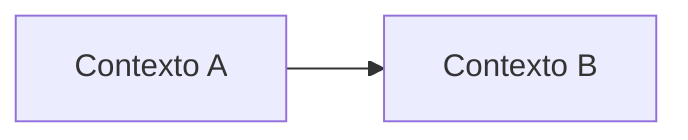

# 1. Modelagem do domínio

## Bounded contexts

<!-- Liste os contextos delimitados envolvidos na Garantia de Prazo. Cada requisito
deve ter exatamente um contexto responsável. -->

| Contexto | Responsabilidade | Requisitos sob sua responsabilidade |
|---|---|---|
| | | |
| | | |
| | | |
| | | |

## Mapa de contexto

<!-- Mostre como os contextos se relacionam: quem consome dados de quem e em que
direção. Pode usar Mermaid, que o GitHub renderiza. -->

## Entidades e agregados

<!-- Para cada agregado: a raiz, as entidades e objetos de valor que ele contém e a
regra de consistência que ele protege. -->

| Agregado | Raiz | Entidades e objetos de valor | Regra que protege |
|---|---|---|---|
| | | | |

## Linguagem ubíqua

<!-- Termos do negócio com a definição que a equipe vai usar no código. Ex.: atraso,
crédito, teto, ausência comprovada. -->

| Termo | Definição |
|---|---|
| | |
