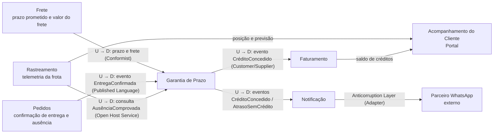

# 1. Modelagem do domínio

## Bounded contexts

| Contexto | Responsabilidade | Requisitos sob sua responsabilidade |
|---|---|---|
| **Garantia de Prazo** | Mede o atraso de cada entrega e decide se há crédito e de quanto, conforme o tipo de cliente. Garante um único crédito por entrega | RF01, RF02, RF03, RF04, RF09, RNF02 |
| **Rastreamento** (telemetria da frota) | Recebe as posições dos veículos, mantém a última posição e a previsão de chegada e responde se uma ausência do destinatário está comprovada | RF05, RNF01 |
| **Faturamento** | Emite a nota de crédito com número sequencial único e mantém o saldo de créditos do cliente | RF06, RNF03 |
| **Notificação** | Avisa o cliente pelo canal preferido (e-mail ou WhatsApp), com retentativa e registro da falha final | RF07, RF08 |
| **Acompanhamento do Cliente** (Portal) | Mostra ao cliente posição do veículo, previsão de chegada e saldo de créditos, atualizados ao vivo | RF10 |
| **Pedidos** e **Frete** (já existentes) | Pedidos registra a confirmação de entrega e a ausência do destinatário; Frete calcula o valor do frete e o prazo prometido. São fornecedores de dados da Garantia e não ganham regra nova | — |

RNF04 (contêineres) é transversal: vale para todos os serviços e não pertence a um contexto de negócio.

## Mapa de contexto

Leitura do mapa: a seta vai do contexto que **fornece** (upstream, U) para o que **consome** (downstream, D).

- **Garantia de Prazo** é o núcleo da solução (core domain). Ela não conhece os detalhes internos de Frete, Pedidos ou Rastreamento: recebe deles apenas o que precisa (prazo prometido, valor do frete, data/hora da confirmação e a resposta "ausência comprovada: sim/não").
- **Notificação** protege o restante do sistema do formato diferente da API do parceiro de WhatsApp com uma camada anticorrupção.
- **Acompanhamento do Cliente** só lê dados; não decide nada.

## Entidades e agregados

| Agregado | Raiz | Entidades e objetos de valor | Regra que protege |
|---|---|---|---|
| Garantia da Entrega | `GarantiaDeEntrega` (uma por entrega) | `IdConfirmacao`, `PrazoPrometido`, `MomentoDaConfirmacao`, `Atraso` (VO, em horas), `TipoDeCliente` (VO), `ValorDoFrete` (VO, dinheiro), `Credito` (VO: valor, percentual aplicado) | Uma entrega gera **no máximo um crédito** (RF09); crédito = percentual da faixa × frete, limitado ao teto do tipo de cliente (RF02, RF03); sem crédito se houver ausência comprovada (RF05) |
| Política de Crédito | `PoliticaDeCredito` (uma por tipo de cliente) | `FaixaDeAtraso` (VO: de, até, percentual), `Teto` (VO, dinheiro), `Tolerancia` (VO, 2 h) | Faixas sem sobreposição e cobrindo todo atraso acima da tolerância; um tipo novo é uma política nova, sem alterar as existentes (RF04) |
| Rastreamento do Veículo | `Veiculo` | `Posicao` (VO: lat, long, instante), `PrevisaoDeChegada` (VO) | Só aceita posição mais recente que a última conhecida (pacotes atrasados ou perdidos não corrompem o estado, RNF01) |
| Nota de Crédito | `NotaDeCredito` | `NumeroDaNota` (VO, sequencial), `IdCredito`, `Valor`, `Cliente` | Número único e nunca repetido (RF06, RNF03); uma nota por crédito |
| Notificação | `Notificacao` | `CanalPreferido` (VO: e-mail ou WhatsApp), `Tentativa` (entidade: número, instante, resultado), `StatusDeEnvio` | No máximo 3 retentativas; falha final fica registrada e é encaminhada para tratamento, nunca descartada (RF08) |

## Linguagem ubíqua

| Termo | Definição |
|---|---|
| Prazo prometido | Data e hora limite de entrega informada pelo serviço de Frete no momento da contratação |
| Confirmação de entrega | Registro, feito pelo serviço de Pedidos, de que a entrega foi concluída, com data e hora. Tem um identificador único (`IdConfirmacao`) |
| Atraso | Diferença em horas entre a confirmação de entrega e o prazo prometido. Se a entrega foi antes do prazo, o atraso é zero |
| Tolerância | Atraso de até 2 h que não gera crédito |
| Faixa de atraso | Intervalo de atraso associado a um percentual: (2 h, 24 h] → 10%; (24 h, 72 h] → 25%; acima de 72 h → 50% (valores do Varejo) |
| Crédito | Valor devolvido ao cliente por causa do atraso: percentual da faixa × valor do frete, limitado ao teto |
| Teto | Valor máximo de crédito por pedido: R$ 500 (Varejo) ou R$ 2.000 (Corporativo) |
| Tipo de cliente | Varejo, Corporativo ou Cortesia. Cada tipo tem a sua política de crédito |
| Cliente Cortesia | Cliente com frete zero: nunca recebe crédito, mas é avisado do atraso |
| Ausência comprovada | Destinatário ausente confirmado pela telemetria: veículo parado a até 200 m do endereço por pelo menos 10 min antes do registro da ausência. Anula o crédito |
| Nota de crédito | Documento do Faturamento que formaliza o crédito, com número sequencial único |
| Saldo de créditos | Soma dos créditos concedidos ao cliente e ainda não utilizados |
| Canal preferido | Meio escolhido pelo cliente para receber avisos: e-mail ou WhatsApp |
| Falha final de envio | Notificação que falhou na tentativa original e nas 3 retentativas; vai para uma fila de falhas para tratamento |
