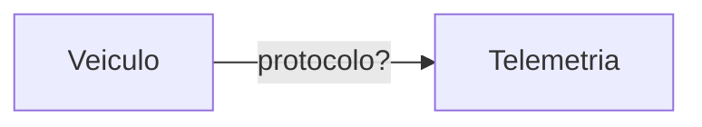

# 2. Arquitetura

## Diagrama dos serviços

<!-- Desenhe os serviços e cada comunicação entre eles. Toda seta indica o protocolo
usado (TCP, UDP, HTTP, SSE, ...). -->



## Protocolo de cada comunicação

| Origem | Destino | Protocolo | Requisito atendido | Justificativa |
|---|---|---|---|---|
| | | | | |

## Padrões de projeto

<!-- Para cada ponto da solução onde um padrão se aplica: qual padrão, qual problema
ele resolve e qual requisito motiva a escolha. -->

| Ponto da solução | Padrão | Requisito | Justificativa |
|---|---|---|---|
| | | | |

### Ponto onde a dupla decidiu não aplicar padrão

<!-- Descreva pelo menos um lugar onde um padrão parecia cabível e a dupla optou por
não aplicar. Explique o motivo. -->

## Confirmação de entrega duplicada (RF09)

<!-- Como a solução garante um único crédito quando a mesma confirmação chega duas
vezes? Onde essa garantia fica implementada? -->

## Numeração das notas de crédito (RF06 e RNF03)

<!-- Como a solução garante número sequencial sem repetição sob concorrência? -->

## Execução em contêineres (RNF04)

<!-- Esboço do compose.yaml: serviços, portas e dependências. Não precisa executar. -->

```yaml
services:
```
