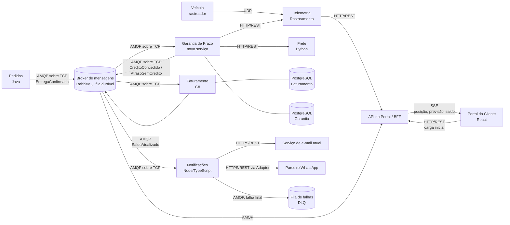

# 2. Arquitetura

## Diagrama dos serviços



## Protocolo de cada comunicação

| Origem | Destino | Protocolo | Requisito atendido | Justificativa |
|---|---|---|---|---|
| Veículo | Telemetria | **UDP** | RNF01 | Posição a cada 30 s e perda tolerada: um pacote perdido é substituído pelo próximo em 30 s. UDP não tem handshake nem retransmissão, o que reduz consumo de dados e bateria do rastreador |
| Pedidos | Broker → Garantia | **AMQP sobre TCP**, fila durável com confirmação (ack) manual | RNF01, RNF02, RF09 | A confirmação de entrega **não pode se perder**: a mensagem fica persistida no broker até a Garantia confirmar o processamento. Se a Garantia cair, a mensagem espera. A entrega "pelo menos uma vez" pode duplicar a mensagem, por isso a Garantia é idempotente (RF09) |
| Garantia | Frete | **HTTP/REST** síncrono | RF01, RF02 | A Garantia precisa do prazo prometido e do valor do frete para calcular o crédito naquele momento. É consulta simples de pedido/resposta, e o Frete já expõe API HTTP |
| Garantia | Telemetria | **HTTP/REST** síncrono | RF05 | Pergunta pontual "houve ausência comprovada para esta entrega?". Resposta imediata, necessária antes de decidir o crédito |
| Garantia | Broker → Faturamento | **AMQP sobre TCP**, fila durável | RF06, RNF02 | O crédito decidido não pode se perder e o Faturamento pode estar ocupado ou fora do ar. A fila desacopla os dois e garante a emissão dentro dos 5 min mesmo com picos |
| Garantia | Broker → Notificações | **AMQP sobre TCP** (mesmo evento, outra fila) | RF03, RF07 | O mesmo evento `CreditoConcedido` (ou `AtrasoSemCredito`, para Cortesia) é consumido por Faturamento e Notificações sem que a Garantia conheça os dois (publicação/assinatura) |
| Notificações | Serviço de e-mail | **HTTPS/REST** | RF07 | Integração já existente, mantida como está |
| Notificações | Parceiro WhatsApp | **HTTPS/REST** | RF07, RF08 | API externa do parceiro. Erros HTTP 5xx ou timeout disparam retentativa (até 3) |
| Notificações | Fila de falhas (DLQ) | **AMQP sobre TCP** | RF08 | A falha final fica persistida em fila própria para reprocessamento ou análise, nunca descartada em silêncio |
| Faturamento / Telemetria | API do Portal (BFF) | AMQP (saldo) e HTTP/REST (posição) | RF10 | O BFF junta posição, previsão e saldo num só lugar para o Portal |
| Portal (navegador) | API do Portal | **HTTP/REST** | RF10 | Carga inicial da tela (dados atuais do pedido) |
| API do Portal | Portal (navegador) | **SSE** (Server-Sent Events) | RF10 | Atualização ao vivo só no sentido servidor → cliente: o cliente não envia nada pela mesma conexão. SSE roda sobre HTTP comum, reconecta sozinho e é mais simples que WebSocket para esse caso |

## Padrões de projeto

| Ponto da solução | Padrão | Requisito | Justificativa |
|---|---|---|---|
| Regra de cálculo do crédito por tipo de cliente | **Strategy** (uma `PoliticaDeCredito` por tipo: Varejo, Corporativo, Cortesia) com um registro tipo → política | RF02, RF03, RF04 | Cada tipo de cliente tem percentuais e teto próprios. Um tipo novo no próximo trimestre vira **uma classe nova registrada**, sem alterar as políticas existentes (aberto para extensão, fechado para modificação) |
| Envio pelo WhatsApp | **Adapter** (`AdaptadorWhatsApp` implementa a mesma interface `CanalDeNotificacao` do e-mail) | RF07 | A API do parceiro tem formato diferente. O adaptador converte a mensagem interna para o formato do parceiro, e o resto do serviço de Notificações não muda |
| Escolha do canal | **Strategy** simples (`CanalDeNotificacao` escolhido pelo canal preferido) | RF07 | O canal é escolhido em tempo de execução, conforme o cliente |
| Distribuição do crédito decidido | **Observer / Publish-Subscribe** (evento `CreditoConcedido` no broker) | RF06, RF07, RF10 | Faturamento, Notificações e Portal reagem ao mesmo fato sem que a Garantia dependa deles |
| Falha de envio | **Retry** com espera crescente (1 s, 2 s, 4 s) + **Dead Letter Queue** | RF08 | Falhas temporárias se resolvem sozinhas na retentativa; a falha final vai para a DLQ e fica visível |
| Confirmação duplicada | **Consumidor idempotente** (chave de idempotência = `IdConfirmacao`) | RF09 | Ver seção abaixo |

### Ponto onde a dupla decidiu não aplicar padrão

**Faixas de atraso dentro de cada política.** Parecia caber um *Chain of Responsibility* (um elo por faixa: tolerância → 10% → 25% → 50%). Decidimos **não aplicar**: são só quatro faixas fixas, que cabem numa tabela simples (lista de `FaixaDeAtraso`) percorrida em ordem. Uma cadeia de objetos deixaria o código maior e mais difícil de ler sem nenhum ganho, já que o que muda no futuro é o **tipo de cliente** (resolvido pelo Strategy), não a forma de percorrer as faixas.

Também **não usamos Adapter para o e-mail**: o serviço atual já fala o formato interno, então ele implementa a interface `CanalDeNotificacao` diretamente. E **não usamos Singleton** para o contador de notas de crédito: um contador em memória não funciona com várias instâncias do serviço (ver RNF03).

## Confirmação de entrega duplicada (RF09)

O broker entrega a confirmação "pelo menos uma vez", então a duplicação pode acontecer (reenvio de Pedidos ou reentrega do broker após falha antes do ack).

A garantia fica **no serviço Garantia de Prazo, no banco de dados**:

1. A tabela `garantia_entrega` tem **restrição `UNIQUE` em `id_confirmacao`**.
2. Ao receber a mensagem, a Garantia faz, numa única transação, `INSERT` da garantia e do crédito e grava o evento `CreditoConcedido` numa tabela *outbox*.
3. Se a mesma confirmação chegar de novo, o `INSERT` viola a restrição única: a Garantia **ignora a mensagem e dá ack**, sem gerar outro crédito.
4. Um processo lê a outbox e publica o evento no broker. O Faturamento também usa o `id_credito` como chave única, para não emitir duas notas caso o evento seja republicado.

A verificação é feita pelo banco e não por um `if` no código ("já existe?") porque duas cópias processadas ao mesmo tempo passariam juntas pelo `if`.

## Numeração das notas de crédito (RF06 e RNF03)

O número vem de uma **`SEQUENCE` do PostgreSQL** do Faturamento (`nextval('seq_nota_credito')`), mais uma restrição `UNIQUE` na coluna `numero`.

- A sequence é atômica no banco: mesmo com 1.000 emissões concorrentes, de várias instâncias do serviço, cada chamada recebe um número diferente.
- Não usamos `SELECT MAX(numero) + 1` (duas transações leriam o mesmo máximo) nem contador em memória (cada instância teria o seu).
- A sequence pode deixar "buracos" se uma transação for desfeita; o requisito pede número **sequencial e nunca repetido**, e isso é garantido. Se o negócio exigir numeração sem buracos, a alternativa é uma tabela de contador com `SELECT ... FOR UPDATE`, mais lenta.

## Execução em contêineres (RNF04)

Tudo sobe com `docker compose up`.

```yaml
services:
  broker:
    image: rabbitmq:3-management
    ports: ["5672:5672", "15672:15672"]

  db-garantia:
    image: postgres:16
    environment: { POSTGRES_DB: garantia, POSTGRES_PASSWORD: dev }

  db-faturamento:
    image: postgres:16
    environment: { POSTGRES_DB: faturamento, POSTGRES_PASSWORD: dev }

  telemetria:
    build: ./telemetria
    ports: ["9000:9000/udp", "8081:8080"]

  pedidos:
    build: ./pedidos            # Java
    ports: ["8082:8080"]
    depends_on: [broker]

  frete:
    build: ./frete              # Python
    ports: ["8083:8000"]

  garantia:
    build: ./garantia
    ports: ["8084:8080"]
    depends_on: [broker, db-garantia, frete, telemetria]

  faturamento:
    build: ./faturamento        # C#
    ports: ["8085:8080"]
    depends_on: [broker, db-faturamento]

  notificacoes:
    build: ./notificacoes       # Node/TypeScript
    ports: ["8086:3000"]
    depends_on: [broker]

  portal-api:
    build: ./portal-api
    ports: ["8087:8080"]
    depends_on: [broker, telemetria, faturamento]

  portal:
    build: ./portal             # React
    ports: ["3000:80"]
    depends_on: [portal-api]
```
